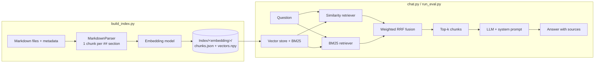

# Markdown RAG

A Retrieval-Augmented Generation (RAG) system that ingests a folder of Markdown documents and answers free-form questions about them, **with cited sources**. It ships with an evaluation harness that measures retrieval and answer quality, so every change (embedding model, chunking, retriever weights) can be judged on numbers instead of impressions.

- **Hybrid retrieval**: dense vector search + BM25 lexical search, fused with weighted Reciprocal Rank Fusion
- **Index once, reuse everywhere**: embeddings are computed one time and saved to disk; chat and evaluation load them without re-embedding
- **Grounded answers**: the LLM only sees the retrieved chunks, must cite their ids, and must answer `No answer found.` when the documents do not contain the answer
- **Built-in evaluation**: hit@k, recall@k, precision@k, MRR, nDCG@k, plus an optional LLM-as-judge and an automatic failure diagnosis
- **Pluggable parts**: 4 embedding models out of the box, any LLM through a small `LLM` base class

---

## How it works



1. **Indexing** (`build_index.py`): each document is split into chunks, one per `##` section. Every chunk is prefixed with its page and section title (`Page name - Section title`), which makes entity names visible to both the embedding model and BM25. The chunks are embedded and saved to disk with their vectors.
2. **Loading** (`config.loadRag`): the saved chunks and vectors are read back and placed in the vector store. Nothing is embedded again; only the embedding model is reloaded, to embed incoming questions. The BM25 index is rebuilt in memory at each start.
3. **Answering** (`chat.py`): a question goes to the similarity and BM25 retrievers, their rankings are merged, and the top chunks are given to the LLM with a system prompt that forces grounded, cited answers.
4. **Evaluating** (`run_eval.py`): a file of questions with expected sources is replayed against the retrievers (and optionally the LLM), and a JSON report is saved for each run.

## Project structure

```
build_index.py      Parse documents, embed chunks, save the index
chat.py             Interactive question answering in the terminal
run_eval.py         Run the evaluation and save a report
config.py           All settings shared by the three scripts
rag.py              RAG class: embedding model, vector store, BM25, hybrid retriever, index save/load
document_parser.py  MarkdownParser: Markdown files -> chunks
evaluator.py        RAGEvaluator: metrics, LLM judge, diagnosis, reports
llm.py              LLM base class and Groq API client
Eval/               Evaluation questions and saved reports
Index/              Generated indexes (one folder per embedding model)
```

## Quick start

### 1. Install

Requires Python 3.12 or later (developed with 3.14). A GPU is optional: the embedding model runs in fp16 on CUDA when available and on CPU otherwise.

```bash
pip install -r requirements.txt
```

For a CUDA build of PyTorch, install it first following [pytorch.org](https://pytorch.org/get-started/locally/).

### 2. Prepare your documents

Put your Markdown files in a folder and describe them in a metadata JSON file (see [Input format](#input-format)). If you only have plain files, this generates a minimal metadata file:

```python
import json
from pathlib import Path

docs = Path("./docs")
meta = {p.stem: {"title": p.stem, "category": None} for p in docs.glob("*.md")}
Path("./pages.json").write_text(json.dumps(meta, indent=2), encoding="utf-8")
```

### 3. Configure

Edit `config.py`:

```python
MARKDOWN_DIR = "./docs"
META_FILE = "./pages.json"
EMBEDDING = "BGE-M3"
```

Rewrite the `SYSTEM` prompt for your domain: the default one describes the project the code was tested on.

### 4. Build the index

```bash
python build_index.py
```

This is the slow step. Run it once per embedding model, and again whenever the documents or the parser change.

### 5. Ask questions

An LLM API key is needed to generate answers (Groq is the built-in client, it is free but is very limited):

```bash
export GROQ_API_KEY="..."      # PowerShell: $env:GROQ_API_KEY = "..."
python chat.py
```

Retrieval alone (and its evaluation) needs no API key.

## Input format

**Markdown files**, one document per file in `MARKDOWN_DIR`:

| Element | Behaviour |
|---|---|
| File name (without `.md`) | Used as the page identifier, used in chunk ids and as the title prefix (`_` becomes a space) |
| Text before the first `##` | Becomes the chunk `main` |
| `## Heading` | Starts a new chunk |
| `###` and deeper | Stay inside the chunk of their `##` section |
| Repeated `##` title in a file | Suffixed `-2`, `-3`... to keep ids unique |

`##` are used as markers for new chunks in attempt to keep each chunk at a decent size. A too large chunk could loose information once embedded (depending on the embedder), so `##` were found to be a good solution. Of course, it depends on the formatting of your text files and feel free to adjust the parser.

Each chunk gets the id `PageName#Section title` and the text `Page name - Section title` followed by the section content.

**Metadata file** (`META_FILE`): a JSON object with one entry per Markdown file, keyed by the file name without extension. Every `.md` file must have an entry.

```json
{
  "Page_Name": { "title": "Page_Name", "category": ["Category A", "Category B"], ... },
  "Another_Page": { "title": "Another_Page", "category": null }
}
```

For the moment, only the title and the category is useful for the retrievers but you can also add other metadata as you wish.

⚠️ The metadata is stored with each chunk. Note that `build_index.py` can run the parser with `cleanFilenames=True`, a single use argument which renames files in place when their name contains `%21`, `%2B`, `%27` or `%3A` (URL-encoded character `!`, `+`, `'`, `:`). **Set it to `False` there if you do not want your files touched.** ⚠️

## Configuration

All the settings live in `config.py`.

| Setting | Meaning |
|---|---|
| `MARKDOWN_DIR`, `META_FILE` | Input documents and their metadata |
| `EMBEDDING` | `mini` (all-MiniLM-L6-v2), `Qwen3-0.6B`, `Qwen3-4B` or `BGE-M3` |
| `INDEX_ROOT` | Where indexes are saved (`INDEX_ROOT/<embedding>`) |
| `N_DOCS` | Chunks retrieved by each retriever and given to the LLM |
| `HYBRID_WEIGHTS` | `[similarity, lexical]` weights of the fusion |
| `RETRIEVER` | Retriever used to answer: `hybrid`, `similarity` or `lexical` |
| `GENERATOR_MODEL`, `JUDGE_MODEL` | LLMs that answer and that grade |
| `MAX_TOKENS`, `EFFORT`, `TEMPERATURE` | Generation parameters |
| `PAUSE_SECONDS` | Pause between two evaluated questions (API rate limits) |
| `SYSTEM`, `JUDGE_SYSTEM` | System prompts of the generator and the judge |

The index of an embedding model records which model produced it, and `config.loadRag()` reloads that same model for the questions, so vectors and queries can never be mixed across models.

### Using another LLM

`llm.py` defines the `LLM` base class. A new provider only needs a subclass with a `call_LLM(prompt, **kwargs)` method returning the answer text. The retrieved chunks arrive in the `documents` argument as `[{"id": ..., "source": {"type": "text", "text": ...}}]`.

## Evaluation

```bash
python run_eval.py                       # retrieval only, no API call
python run_eval.py --generate            # also generate the answers
python run_eval.py --generate --judge    # also grade them with the judge LLM
python run_eval.py --limit 5             # first 5 questions only
```

Questions live in `Eval/eval_questions.txt`, one block per question:

```
[Q01]
type: lookup
question: What does the feature X do?
gold: Page_A#Section|Page_B#Other section; Page_C
answer: Short reference answer used by the judge.
```

- `gold` lists the expected sources. A page (`Page_C`) accepts any of its chunks, a section (`Page_A#Section`) accepts only that chunk.
- `;` separates sources that are **all** needed (multi-document questions).
- `|` separates **alternative** sources that each contain the answer.
- A question with no `gold` is expected to be answered `No answer found.`.

**Retrieval metrics** (per retriever: similarity, lexical, hybrid): hit@k, recall@k, precision@k, nDCG@k for k in 1, 3, 5, 10, and MRR. Results are also broken down by question type.

**Generation metrics** (optional): a judge LLM scores context relevance, faithfulness, answer relevance and correctness from 0 to 2; the evaluator also measures abstention on unanswerable questions and checks that sources are cited.

**Diagnosis**: each question gets one label (`retrieval_miss`, `ranking`, `false_abstention`, `hallucination`, `unfaithful`, `generation_error`, `no_citation`, `ok`...) following the usual "debug retrieval first" logic, and `printFailures` shows expected versus retrieved chunks.

Every run is saved as JSON in `Eval/` with its configuration, so experiments can be compared later. Change one setting at a time.

### Results

Measured on an internal set of 54 questions about the videogame Baldur's Game 3 (49 answerable, 5 unanswerable; diffent type of questions : lookup, location, quest, multi-hop, trap, paraphrase) over an index of about 72,000 chunks (200 - 1300 words per chunks). The first three steps were measured on an earlier version of the index with 10 chunks per retriever; the last two use the current index and 10 chunks per retriever (`N_DOCS = 10`; hybrid returns up to 10 chunks after fusion):

| Step | hit@10 (hybrid) |
|---|---|
| Baseline: all-MiniLM-L6-v2 embeddings, BM25 tokenizer | 0.61 |
| + page/section title prefix inside chunks, normalised BM25 tokenizer | 0.78 |
| + changed to BGE-M3 embeddings | 0.90 |
| + alternative gold sources added that also had the elements to answer the questions (fusion weights 0.7 / 0.3 and 0.8 / 0.2 both give this score) | 1.00 |

Final configuration (BGE-M3, hybrid 0.7 / 0.3, 10 chunks per retriever (20 chunks in total and 10 chunks eventually chosen after the fusion)):

| Retriever | hit@1 | hit@3 | hit@10 | recall@10 | MRR | nDCG@10 |
|---|---|---|---|---|---|---|
| Similarity | 0.76 | 0.98 | 0.98 | 0.96 | 0.86 | 0.88 |
| Lexical (BM25) | 0.35 | 0.47 | 0.57 | 0.56 | 0.43 | 0.46 |
| Hybrid | 0.65 | 0.98 | 1.00 | 0.98 | 0.80 | 0.84 |

Retrieval takes about 1.3 s per question. By question type, hybrid reaches a recall@10 of 1.00 on lookup, location, quest, trap and paraphrase questions; the only misses are two multi-document questions (recall@10 0.80 on that type), where one of the two required sources is not retrieved. The similarity retriever alone ranks better at the top (hit@1 0.76 against 0.65 for hybrid); hybrid is what brings the last missing sources into the retrieved set.

Read these numbers with care: the question set is small and the evaluation set is nearly saturated, so it can no longer tell small improvements apart. End-to-end answer quality (generation and judge) is implemented but has not been benchmarked yet.

## Design notes

- **Title prefix on every chunk.** Sometimes, a section title is not enough for the retrievers to find the information inside the documents; prefixing the page and section title lets both embeddings and BM25 match the entity a question is about. It works very well when the title contains words specific to the vocabulary of the studied field, like proper nouns (Karlach, Wyll, ...)

- **Custom BM25 tokenizer.** The default tokenizer splits on whitespace only, so `cache?` never matches `cache`. Lowercasing, punctuation removal and stop-word filtering, together with the title prefix, took the lexical retriever alone from 0.27 to 0.57 hit@10. It helps the BM25 tokenizer to focus on important words of the user's query.

- **Embeddings decoupled from the vector store.** Vectors are computed in blocks of similar length, stored as a float32 matrix, and handed to the store through a wrapper (`PrecomputedEmbeddings`). Python lists of floats would use about 8 times more memory, which matters with an in-memory store. Alternatives could be used to avoid this issue (see the next section : **Limitations and roadmap**)

## Limitations and roadmap

- Only Markdown with `##` sections and a metadata file is supported.
- The vector store is in memory (`InMemoryVectorStore`); a disk-backed store such as FAISS would lower memory use for large corpora.
- Chunks longer than the embedding model's context window are truncated; splitting long sections into overlapping sub-chunks is not implemented.
- Questions involving two entities can miss one of them, since a single query is embedded. Query decomposition with an LLM is the natural fix.
- A cross-encoder reranker on the top candidates is not implemented.
- The only built-in LLM client is Groq.

## License

Released under the [MIT License](LICENSE).
