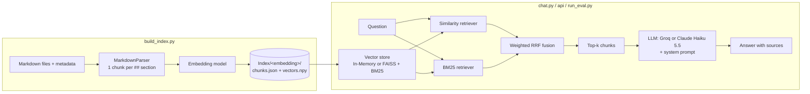

# Markdown RAG

Ask questions about a folder of Markdown documents and get answers **with cited sources**.

This is a complete Retrieval-Augmented Generation (RAG) system. It splits your documents into chunks, finds the passages that are most relevant to a question (vector search and keyword search combined), and gives **only those passages** to an LLM, which must cite them, or answer `No answer found.` when the documents do not contain the answer. It ships with a demo corpus about the Solar System, a small web page and HTTP API, an evaluation harness and a Docker setup: you can try it in a few minutes, then point it at your own documents.

- **Hybrid retrieval**: dense vector search + BM25 keyword search, fused with weighted Reciprocal Rank Fusion
- **Index once, reuse everywhere**: embeddings are computed one time and saved to disk; the chat, the API and the evaluation load them without re-embedding
- **Two vector stores** (in-memory or FAISS) and **two LLM providers** (Groq or Claude Haiku 5.5), each switched with one setting; a small abstract `LLM` class makes it easy to add more
- **Grounded answers**: the LLM only sees the retrieved chunks, must cite their ids, and answers `No answer found.` when they do not contain the answer
- **Built-in evaluation**: hit@k, recall@k, precision@k, MRR, nDCG@k, plus an optional LLM-as-judge and an automatic failure diagnosis
- **Ready to run**: a demo corpus (20 pages, 30 evaluation questions), a web page and FastAPI service, and Docker

**Where to go from here:** [Installation](#installation) to get it running, [The main scripts](#the-main-scripts) to see what each one does, [How it works in detail](#how-it-works-in-detail) for the pipeline, the configuration and the design choices, [Evaluation](#evaluation) for the metrics and the results.

---

## Installation

Both options give you a working project on the included demo corpus (20 pages about the Solar System): `config.py` is already set up for it. Get the code first:

```bash
git clone <repository-url>
cd <repository-folder>
```

### Option 1: Python on your machine

Requires Python 3.12 or later (developed with 3.14). A GPU is optional: the embedding model runs on CUDA when available (works fine with 6GB of VRAM) and on CPU otherwise.

```bash
pip install -r requirements.txt
```

For a CUDA build of PyTorch, install it first following [pytorch.org](https://pytorch.org/get-started/locally/). On a machine without a GPU, install the much smaller CPU build first: `pip install torch --index-url https://download.pytorch.org/whl/cpu`.

All the commands below are run from the `src/` folder. Build the index once:

```bash
cd src
python build_index.py
```

The first run downloads the embedding model from Hugging Face (about 2.3 GB for BGE-M3; set `EMBEDDING = "mini"` in `config.py` for a much lighter download of about 90 MB). The demo corpus (135 chunks) is then indexed in under a minute on a laptop with a GPU.

Then start the web page and API, or ask questions in the terminal:

```bash
python chat.py            # questions in the terminal, needs an LLM API key

fastapi dev api/main.py   # web page and API on http://localhost:8000, you can try the retrieve task without consumming any token, how the LLM answers should only be based one the documents retrieved so feel free to test the retrieval power.
```

<summary>What the dependencies are used for</summary>

| Package | Used for |
|---|---|
| `torch`, `sentence-transformers`, `langchain-huggingface` | Embedding models |
| `langchain-core`, `langchain-community`, `langchain-classic` | Vector stores, BM25 retriever, hybrid (ensemble) retriever |
| `rank-bm25` | BM25 scoring |
| `faiss-cpu` | FAISS vector store. Imported at startup, so it must be installed even with `STORE = "In-Memory"` |
| `numpy` | Vector matrices |
| `fastapi[standard]` | HTTP API (FastAPI, uvicorn and the `fastapi dev` command). 0.141 or later, for the web page served on `/` |
| `requests` | Groq API |
| `anthropic` | Claude client. Only imported when the Claude client is created, so it is optional if you only use Groq |

### Option 2: Docker

You only need [Docker](https://docs.docker.com/get-started/get-docker/) with the Compose plugin (Docker Desktop, or Docker Engine on Linux or WSL2). Nothing else is installed on your machine.

```bash
cp .env.example .env                                # API keys; can stay empty to try the retrieval
docker compose build                                # builds the image (code and CPU dependencies)
docker compose run --rm api python build_index.py   # builds the index, once
docker compose up                                   # starts the API
```

1. `.env` holds your API keys (see [API keys](#api-keys)). It is read at startup and never copied into the image or committed.
2. `build_index.py` downloads the embedding model (about 2.3 GB) into a Docker volume the first time, then embeds the 135 chunks of the demo corpus. Expect a few minutes on a CPU. It is done once.
3. `docker compose up` loads the model (30 to 60 seconds) and starts the API. Open **http://localhost:8000**, type a question and click "Search only".

As shipped, the API's `/ask` route (the answer written by the LLM) is disabled, so the web page shows the retrieved passages. To talk to the LLM from Docker, put your key in `.env` and run `docker compose run --rm api python chat.py`.

What is inside the image and what is not:

| Item | Where | Why |
|---|---|---|
| Code and Python dependencies (CPU-only PyTorch) | In the image | Built by `docker compose build` |
| API keys | `.env`, read at startup (`env_file`) | A secret must never be written in the image or committed |
| Index | Docker volume `index`, mounted on `/app/src/Index` | Built once, survives rebuilds of the image |
| Embedding model (BGE-M3, about 2.3 GB) | Docker volume `hf_cache`, mounted on the Hugging Face cache | Downloaded once, on the first run |
| `Scrap/`, `Eval/`, `Index/`, `.git`, `.env` | Never copied (see `.dockerignore`) | Private or generated files |

- Plan about 4 to 6 GB of memory for the container. With Docker Desktop or WSL2, the limit is set in `%UserProfile%\.wslconfig` (`memory=`).
- `docker compose down` stops the API and keeps the volumes; `docker compose down -v` also deletes the index and the model cache.
- If the container is killed (exit code 137), it ran out of memory. If it stays `unhealthy`, look at `docker compose logs`: the model may still be loading (the health check allows 3 minutes). If port 8000 is taken, change `"8000:8000"` in `docker-compose.yml`.
- Nothing is published anywhere: the image only exists on your machine until you push it to a registry yourself.

### API keys

Retrieving passages needs no key. An LLM key is only needed to generate answers (`chat.py`, `run_eval.py --generate`). Pick the provider with `API` in `config.py` and set its key, either in the environment or, with Docker, in `.env`:

```bash
# Anthropic (API = "Anthropic")
export ANTHROPIC_API_KEY="..."      # PowerShell: $env:ANTHROPIC_API_KEY = "..."

# Groq (API = "Groq")
export GROQ_API_KEY="..."           # PowerShell: $env:GROQ_API_KEY = "..."
```

### Check that it works

Open the web page, type `How many moons does Saturn have?` and click "Search only": the passage from `Saturn#Moons` comes first. Or run `python run_eval.py` from `src/`: it evaluates the retrieval on the 30 demo questions, without any key or paid call.

Questions to try on the demo corpus (with `chat.py`, once a key is set):

- `How many moons does Saturn have?` (one fact in one page)
- `Which is hotter, Venus or Mercury, and why?` (needs two pages)
- `which moon sprays water out of its south pole` (informal wording)
- `How many moons does Haumea have?` (not in the pages: the answer should be `No answer found.`)

## The main scripts

Four entry points, all configured by `src/config.py` and run from `src/`:

| Script | What it does | LLM key | Cost |
|---|---|---|---|
| `build_index.py` | Parses the documents, embeds the chunks, saves the index | no | none |
| `chat.py` | Asks questions in the terminal | yes | tokens |
| `run_eval.py` | Evaluates the retrieval and, optionally, the answers | only with `--generate` / `--judge` | none by default |
| `api/main.py` | Web page and HTTP API | only for `/ask`, which is disabled as shipped | none as shipped |

### build_index.py

```bash
python build_index.py
```

Splits every Markdown file of `MARKDOWN_DIR` into chunks (one per `##` section), embeds them with the model chosen by `EMBEDDING`, and saves chunks and vectors in `INDEX_ROOT/<embedding>/` (`chunks.json`, `vectors.npy`, `index.json`). This is the slow step: run it once per embedding model, and again whenever the documents or the parser change. Changing `STORE`, `API`, `N_DOCS` or `HYBRID_WEIGHTS` does **not** require a new index. Note that it runs the parser with `cleanFilenames=True`, which renames some files in place (see [Input format](#input-format)).

### chat.py

```bash
python chat.py
```

Asks for a question in the terminal, retrieves the `N_DOCS` best chunks with the retriever set by `RETRIEVER`, sends them to the LLM set by `API`, and prints the answer with its sources. Type `exit` to leave. It needs the index and an LLM key; each answer costs tokens.

### run_eval.py

```bash
python run_eval.py                                    # retrieval only, no API call
python run_eval.py --generate Anthropic               # also generate the answers with Claude
python run_eval.py --generate Groq --judge Anthropic  # generate with Groq, grade with Claude
python run_eval.py --limit 5                          # first 5 questions only
```

Replays the questions of `QUESTIONS_FILE` (the 30 demo questions by default) against the retrievers, prints the metrics and the failed questions, and saves a JSON report in `Eval/`. See [Evaluation](#evaluation).

### api/main.py: HTTP API and web page

`src/api/` exposes the RAG with FastAPI. The index, the embedding model and the LLM client are loaded **once**, when the server starts (30 to 60 seconds with BGE-M3), and then shared by all the requests. Start it from `src/` (or with Docker, see [Installation](#option-1-docker)):

```bash
fastapi dev api/main.py
```

`fastapi dev` reloads the server (and therefore the model) at each code change. For a server without reload: `uvicorn api.main:app --host 0.0.0.0 --port 8000`. Then open `http://localhost:8000` for the web page, or `http://localhost:8000/docs` for the interactive documentation, where every route can be tried.

| Route | Method | What it does | Tokens |
|---|---|---|---|
| `/` | GET | Web page with a question field and two buttons, "Search only" and "Ask" | none |
| `/health` | GET | Number of chunks and retrievers loaded | none |
| `/info` | GET | Embedding model, vector store, retrievers, LLM model, tokens used so far and system prompt | none |
| `/retrieve` | POST | The `N_DOCS` most relevant chunks for a question, as a list of `{"id", "text"}` | none |
| `/ask` | POST | The answer written by the LLM from these chunks | **yes** |

The POST routes take a JSON body `{"question": "..."}` of 8 to 512 characters (anything else gets a 422 error):

```bash
curl -X POST http://localhost:8000/retrieve -H "Content-Type: application/json" -d '{"question": "How many moons does Saturn have?"}'
```

`/ask` is **disabled in the shipped code**: its body is empty on purpose, so that a public demo cannot spend tokens. To enable it, call `pipeline.QAPipeline(query.question)` in `api/main.py` and return an `AskResponse` built from the answer and the documents. The "Ask" button of the web page calls this route.

The API has no authentication and no rate limit, and `/info` shows the system prompt: do not expose it on the Internet as it is. Both the API and `chat.py` use `RAGPipeline` (`src/pipeline.py`), so a question is answered the same way everywhere.

---

## How it works in detail

### The pipeline



1. **Indexing** (`build_index.py`): each document is split into chunks, one per `##` section. Every chunk is prefixed with its page and section title (`Page name - Section title`), which makes entity names visible to both the embedding model and BM25. The chunks are embedded and saved to disk with their vectors.
2. **Loading** (`config.loadRag`): the saved chunks and vectors are read back and placed in the vector store chosen by `STORE`. Nothing is embedded again; only the embedding model is reloaded, to embed incoming questions. The BM25 index (and the FAISS index, if selected) is rebuilt in memory at each start.
3. **Answering** (`chat.py` or the [HTTP API](#apimainpy-http-api-and-web-page)): a question goes to the similarity and BM25 retrievers, their rankings are merged, and the top `N_DOCS` chunks are given to the LLM with a system prompt that forces grounded, cited answers.
4. **Evaluating** (`run_eval.py`): a file of questions with expected sources is replayed against the retrievers (and optionally the LLM), and a JSON report is saved for each run.

### Project structure

```
requirements.txt        Python dependencies
Dockerfile              Image of the API (see Installation)
docker-compose.yml      Runs the API with its volumes and settings
.dockerignore           Files that must never enter the image
.env.example            Template of the file holding the API keys
src/
  build_index.py        Parse documents, embed chunks, save the index
  chat.py               Interactive question answering in the terminal
  run_eval.py           Run the evaluation and save a report
  config.py             All settings shared by the scripts and the API, and the factories of the LLM clients
  pipeline.py           RAGPipeline: retrieval and question answering, used by chat.py and the API
  rag.py                RAG class: embedding model, vector store (In-Memory or FAISS), BM25, hybrid retriever, index save/load
  document_parser.py    MarkdownParser: Markdown files -> chunks
  evaluator.py          RAGEvaluator: metrics, LLM judge, diagnosis, reports
  llm.py                Abstract LLM class, Groq client, Claude client (Anthropic)
  api/
    main.py             FastAPI app: loads the RAG at startup, routes, serves the web page
    schemas.py          Pydantic models of the requests and responses
    static/index.html   Web page served on "/"
  Demo/                 Demo corpus: pages/ (20 Markdown pages), pages.json (metadata), eval_questions.txt (30 questions)
  Eval/                 Saved evaluation reports (git-ignored)
  Index/                Generated indexes, one folder per embedding model (git-ignored)
```

### Demo corpus

The `Demo/` folder contains a complete, small corpus in the format the project expects, so that anyone can reproduce the pipeline without the author's private wiki:

| Group | Pages |
|---|---|
| Star | Sun |
| Planets (8) | Mercury, Venus, Earth, Mars, Jupiter, Saturn, Uranus, Neptune |
| Moons (6) | Moon, Io, Europa, Ganymede, Titan, Enceladus |
| Dwarf planets and small bodies (5) | Pluto, Ceres, Asteroid belt, Kuiper belt, Comets |

- `Demo/pages/*.md`: 20 pages written for this repository from public sources such as NASA and ESA. Each page starts with a short text (the `main` chunk) followed by 5 or 6 `##` sections (quick facts, atmosphere, orbit, exploration...), which gives 135 chunks. Figures are rounded, and counts that change over time, such as the number of moons, carry the year of the count.
- `Demo/pages.json`: the metadata file, with the title and the categories of each page (for example `Planets`, `Moons of Jupiter`, `Dwarf planets`).
- `Demo/eval_questions.txt`: 30 evaluation questions with their expected sources and reference answers: 8 lookup, 4 mission, 4 multi-hop, 4 trap, 5 paraphrase and 5 unanswerable questions. The expected sources were checked against the pages before the first run and were not adjusted afterwards to improve the scores.

The demo index is saved in `Index/demo/`, apart from any other index.

### Using your own documents

#### 1. Prepare your documents

Put your Markdown files in a folder and describe them in a metadata JSON file (see [Input format](#input-format)). If you only have plain files, this generates a minimal metadata file:

```python
import json
from pathlib import Path

docs = Path("./docs")
meta = {p.stem: {"title": p.stem, "category": None} for p in docs.glob("*.md")}
Path("./pages.json").write_text(json.dumps(meta, indent=2), encoding="utf-8")
```

#### 2. Configure

Edit `config.py`:

```python
MARKDOWN_DIR = "../docs"                  # a string is relative to the folder you run the scripts from
META_FILE = "../pages.json"
INDEX_ROOT = "./Index/mydocs"            # keeps your index apart from the demo one
QUESTIONS_FILE = "../mydocs_questions.txt" # your own evaluation questions (optional)
EMBEDDING = "BGE-M3"
STORE = "FAISS"          # or "In-Memory"
API = "Anthropic"        # or "Groq"
```

Rewrite the `SYSTEM` prompt for your domain: the default one describes the Solar System of the demo corpus.

#### 3. Build the index and ask questions

```bash
python build_index.py
```

This is the slow step. Run it once per embedding model, and again whenever the documents or the parser change. Changing `STORE`, `API`, `N_DOCS` or `HYBRID_WEIGHTS` does **not** require a new index. Then use `chat.py`, the API or `run_eval.py` as described in [The main scripts](#the-main-scripts).

With Docker, the image only contains the `src/` folder: put your documents under `src/` (or mount a folder in `docker-compose.yml`), set the paths in `config.py` and rebuild the image.

### Input format

**Markdown files**, one document per file in `MARKDOWN_DIR`:

| Element | Behaviour |
|---|---|
| File name (without `.md`) | Used as the page identifier, used in chunk ids and as the title prefix (`_` becomes a space) |
| Text before the first `##` | Becomes the chunk `main` |
| `## Heading` | Starts a new chunk |
| `###` and deeper | Stay inside the chunk of their `##` section |
| Repeated `##` title in a file | Suffixed `-2`, `-3`... to keep ids unique |

`##` are used as markers for new chunks in an attempt to keep each chunk at a decent size. A too large chunk could lose information once embedded (depending on the embedder), so `##` were found to be a good compromise. Of course, it depends on the formatting of your text files and feel free to adjust the parser.

Each chunk gets the id `PageName#Section title` and the text `Page name - Section title` followed by the section content.

**Metadata file** (`META_FILE`): a JSON object with one entry per Markdown file, keyed by the file name without extension. Every `.md` file must have an entry.

```json
{
  "Page_Name": { "title": "Page_Name", "category": ["Category A", "Category B"], ... },
  "Another_Page": { "title": "Another_Page", "category": null }
}
```

For the moment, only the title and the category are used (the category is what `EXCLUDE_CATEGORIES` filters on) but you can also add other metadata as you wish; it is stored with each chunk.

⚠️ `build_index.py` runs the parser with `cleanFilenames=True`, a single use argument which renames files in place when their name contains `%21`, `%2B`, `%27` or `%3A` (URL-encoded characters `!`, `+`, `'`, `:`). **Set it to `False` there if you do not want your files touched.** ⚠️

### Configuration

All the settings live in `config.py`.

| Setting | Meaning |
|---|---|
| `API` | LLM provider used by `chat.py`: `"Anthropic"` (Claude Haiku 5.5) or `"Groq"`. `run_eval.py` takes its providers from command-line flags instead |
| `MARKDOWN_DIR`, `META_FILE`, `EXCLUDE_CATEGORIES` | Input documents, their metadata, and categories left out of the index (the demo corpus by default) |
| `EMBEDDING` | `mini` (all-MiniLM-L6-v2, 384 d), `Qwen3-0.6B` (1024 d), `Qwen3-4B` (2560 d) or `BGE-M3` (1024 d) |
| `STORE` | `"In-Memory"` or `"FAISS"` (see [Choosing a vector store](#choosing-a-vector-store)) |
| `INDEX_ROOT` | Where indexes are saved (`INDEX_ROOT/<embedding>`). `./Index/demo` by default, so that the demo never overwrites another index |
| `N_DOCS` | Chunks returned by each retriever, and given to the LLM (the hybrid retriever is cut to `N_DOCS` after fusion) |
| `HYBRID_WEIGHTS` | `[similarity, lexical]` weights of the fusion |
| `RETRIEVER` | Retriever used to answer: `hybrid`, `similarity` or `lexical` |
| `GENERATOR_MODEL`, `JUDGE_MODEL` | Groq models that answer and that grade. Ignored with Anthropic, which always uses `claude-haiku-5-5` |
| `MAX_TOKENS`, `EFFORT` | Generation parameters, shared by both providers |
| `TEMPERATURE` | Groq only: the Anthropic API rejects it for Haiku 5.5 |
| `QUESTIONS_FILE` | Evaluation questions used by `run_eval.py` (`Demo/eval_questions.txt` by default) |
| `PAUSE_SECONDS` | Pause after each LLM call during an evaluation (API rate limits) |
| `SYSTEM`, `JUDGE_SYSTEM` | System prompts of the generator and the judge |

The index of an embedding model records which model produced it, and `config.loadRag()` reloads that same model for the questions, so vectors and queries can never be mixed across models.

By default the paths of `config.py` are resolved from the folder of the file itself (`src/`), so the scripts and the API work from any directory; a path written as a plain string is relative to the folder you run the script from.

To add an embedding model, add an entry to `RAG.EMBEDDING_MODELS` in `rag.py` with its Hugging Face name and the size of its vectors (the size is checked against the model output, and is needed to create a FAISS index).

#### Choosing a vector store

Both stores answer the same questions with exact (not approximate) search, and both are filled from the same saved vectors, so **you can switch from one to the other with `STORE` and no re-indexing**.

| | `In-Memory` | `FAISS` |
|---|---|---|
| Search | Cosine similarity on all vectors, which are stacked into an array again at every query | Exact search on a flat float32 matrix (`IndexFlatL2`); the ranking is the same as cosine because the embeddings are normalised |
| Extra memory at query time | A temporary copy of all vectors per question | None |
| Persistence | None, filled at each start | None, the index is rebuilt in memory at each start from `vectors.npy` |
| Measured retrieval time (see [Results](#results)) | 1.21 s per question | 0.38 s per question |
| Measured retrieval quality | Identical to FAISS | Identical to In-Memory |

Use `FAISS` by default for anything beyond a toy corpus. Only a flat (exact) index is implemented; approximate indexes (HNSW, IVF) would be the next step for millions of chunks.

#### Choosing an LLM

`LLM` in `llm.py` is an abstract class. Each provider is a subclass that **sets its own parameters in its constructor**, so every client is used the same way (`llm.call_LLM(prompt, documents)`) while exposing only the parameters its API supports.

| | `Groq` | `Claude` (Anthropic) |
|---|---|---|
| Models | `openai/gpt-oss-20b`, `openai/gpt-oss-120b`, `qwen/qwen3.8-27b` | `claude-haiku-5-5` only (the lightest and cheapest model) |
| Key | `GROQ_API_KEY` | `ANTHROPIC_API_KEY` (read by the Anthropic SDK) |
| Parameters | `temperature`, `max_token`, `effort` (`low`/`medium`/`high`, `gpt-oss` models only) | `max_token`, `effort` (`low` to `max`), `thinking` (`True`/`False`). No temperature |
| Cost | Free tier, but strongly rate-limited | Pay per token. At the time of writing Haiku 5.5 costs $0.10 per million input tokens and $0.50 per million output tokens (prompts up to 100K tokens); check the current price |

Notes on Claude Haiku 5.5:

- **The thinking tokens are part of `max_token`.** With `thinking=True`, a `max_token` that is too low can cut the answer or leave no room for it; the client prints a warning when the answer is cut. The evaluation reported below used `max_token = 2048` for the generator.
- `thinking=False` is cheaper but only allowed with an effort of `high` or lower.
- Both clients add up the tokens they consume in `llm.usage` (`input_tokens`, `output_tokens`), which is the way to follow the spending of an evaluation.
- `config.createJudge` uses `effort="medium"` for the Claude judge.

#### Using another LLM

Subclass `LLM` in `llm.py`. `call_LLM` is a template method: it builds the user message from the prompt and the documents, then delegates to your subclass. You only implement:

- `_send(self, content: str) -> str`: call your API with the parameters stored in `self` and return the answer text. Raise `LLMError` (and nothing else) if the API fails, and call `self._addUsage(input_tokens, output_tokens)`.
- `describe(self) -> dict`: provider, model and parameters, saved in every evaluation report.

Then add a branch for it in `createGenerator` and `createJudge` in `config.py`. The retrieved chunks are written into the message as `<id>...</id><document>...</document>` pairs by `LLM.formatDocuments`.

### Design notes

- **Title prefix on every chunk.** Sometimes, a section title is not enough for the retrievers to find the information inside the documents; prefixing the page and section title lets both embeddings and BM25 match the entity a question is about. It works very well when the title contains words specific to the vocabulary of the studied field, like proper nouns.

- **Custom BM25 tokenizer.** The default tokenizer splits on whitespace only, so `cache?` never matches `cache`. Lowercasing, punctuation removal and stop-word filtering, together with the title prefix, took the lexical retriever alone from 0.27 to 0.57 hit@10 at the time. It helps BM25 focus on the important words of the user's query.

- **Retriever sizes are explicit.** The number of chunks of the similarity retriever has to be passed as `search_kwargs={"k": n}`: giving `k=n` directly to `as_retriever` is silently ignored, and the retriever returned only 4 chunks. The BM25 retriever takes `k` as a constructor argument (not in `bm25_params`), and the fusion of two lists of `N_DOCS` chunks is cut back to `N_DOCS`, so every retriever is evaluated and used with the same number of chunks.

- **Embeddings decoupled from the vector store.** Vectors are computed in blocks of similar length, stored as a float32 matrix, and handed to the store through a wrapper (`PrecomputedEmbeddings`). Python lists of floats would use about 8 times more memory, which matters with an in-memory store. This is also what lets both vector stores be filled from the same saved index.

- **LLMs as an abstract class.** `LLM.call_LLM` is a template method (build the message, call `_send`, which each provider implements), and every provider reports its failures as `LLMError`. The evaluator, the chat and the RAG never need to know which provider they use, and generator and judge are just two differently configured instances.

- **One pipeline, several front ends.** `RAGPipeline` holds the question-to-answer logic, and `chat.py` and the API are thin layers over it. The API loads the heavy objects once in FastAPI's `lifespan` and hands them to the routes with a dependency, which also lets tests replace them with fakes.

---

## Evaluation

The evaluation is run with `run_eval.py` (options in [The main scripts](#run_evalpy)): the same questions, the same metrics, and a saved JSON report each time, so that every change can be compared with the previous state.

`--generate` and `--judge` each take `Groq` or `Anthropic`; `--judge` needs `--generate`.

Questions live in the file set by `QUESTIONS_FILE` in `config.py` (`Demo/eval_questions.txt` by default, a complete example), one block per question:

```
[Q01]
type: lookup
question: What does the feature X do?
gold: Page_A#Section|Page_B#Other section; Page_C#Section
answer: Short reference answer used by the judge.
```

- `gold` lists the expected sources. A page (`Page_C`) accepts any of its chunks, a section (`Page_A#Section`) accepts only that chunk. **Prefer sections**: a page-level gold counts any chunk of the page as a hit, even one that does not contain the answer, and hides retrieval failures.
- `;` separates sources that are **all** needed (multi-document questions).
- `|` separates **alternative** sources that each contain the answer.
- A question with no `gold` is expected to be answered `No answer found.`.
- Keep the reference `answer` to what the question asks: the judge is told to ignore extra details of the reference, but shorter references are safer.

**Retrieval metrics** (per retriever: similarity, lexical, hybrid): hit@k, recall@k, precision@k, nDCG@k for k in 1, 3, 5, 10, and MRR. Retrievers return `N_DOCS` chunks, so the metrics at a k above `N_DOCS` equal those at `N_DOCS`. Results are also broken down by question type.

**Generation metrics** (optional): a judge LLM scores context relevance, faithfulness, answer relevance and correctness from 0 to 2, normalised to 0-1; the evaluator also measures abstention on unanswerable questions and checks that sources are cited (an exact chunk id has to appear in the answer). The judge sees the passages exactly as the generator received them.

**Diagnosis**: each question gets one label (`retrieval_miss`, `ranking`, `false_abstention`, `hallucination`, `unfaithful`, `generation_error`, `no_citation`, `ok`...) following the usual "debug retrieval first" logic, and `printFailures` shows expected versus retrieved chunks, the full answer and the judge's reason.

Every run is saved as JSON in the `Eval/` folder of the directory you run it from (`src/Eval/`) with its configuration (including the `describe()` of the generator and the judge), so experiments can be compared later. Change one setting at a time.

### Results

The results below were measured on the author's private corpus, a wiki that cannot be redistributed, which is why the repository ships a demo corpus instead (its own results are given [at the end of this section](#results-on-the-demo-corpus)). They come from an internal set of 54 questions about the videogame Baldur's Gate 3 (49 answerable, 5 unanswerable; different types of questions: lookup, location, quest, multi-hop, trap, paraphrase, unanswerable) over an index of about 72,000 chunks (from a few words to several thousand per chunk).

**How retrieval evolved** (hybrid retriever, hit@10):

| Step | hit@10 |
|---|---|
| Baseline: all-MiniLM-L6-v2 embeddings, default BM25 tokenizer | 0.61 |
| + page/section title prefix inside chunks, normalised BM25 tokenizer | 0.78 |
| + changed to BGE-M3 embeddings | 0.90 |
| + retriever sizes fixed (see [Design notes](#design-notes)) and alternative gold sources added, because several sources can contain the same answer | 1.00 |
| + gold sources tightened to the section that holds the answer, `N_DOCS = 8`, weights 0.8 / 0.2 | 0.98 |

The last step is not a regression: stricter golds no longer count a chunk of the right page that does not contain the answer. The first three rows were measured before the retriever-size fixes, with looser golds and 10 chunks, so they are only indicative.

**Final retrieval** (BGE-M3, weights 0.8 / 0.2, `N_DOCS = 8`, section-level golds, run of 2026-11-05):

| Retriever | hit@1 | hit@3 | hit@5 | hit@10 | recall@10 | MRR | nDCG@10 |
|---|---|---|---|---|---|---|---|
| Similarity | 0.63 | 0.92 | 0.96 | 0.98 | 0.96 | 0.78 | 0.82 |
| Lexical (BM25) | 0.18 | 0.33 | 0.41 | 0.47 | 0.45 | 0.28 | 0.32 |
| Hybrid | 0.49 | 0.86 | 0.96 | 0.98 | 0.96 | 0.66 | 0.73 |

By question type, the hybrid retriever reaches a recall@10 of 1.00 on location, quest, trap and paraphrase questions, 0.93 on lookup and 0.80 on multi-document questions. Three questions fail: one lookup where the chunks holding the answer are never retrieved (`Martial_Prodigy`), and two multi-document questions where only one of the two required sources is retrieved.

Two honest observations: BM25 alone is weak on this corpus, and **the similarity retriever alone ranks better than the hybrid one at the top of the list** (hit@1 0.63 against 0.49) while both retrieve the same sources by rank 10. Hybrid is the default because exact names can matter on other corpora, but `RETRIEVER = "similarity"` is a legitimate choice here.

**Vector store comparison** (same questions, same index): `In-Memory` and `FAISS` give exactly the same metrics. Retrieval, with the three retrievers and the embedding of the question, takes 1.21 s per question with `In-Memory` and 0.38 s with `FAISS` (single run on a laptop with an RTX 4050 6 GB, so take it as an order of magnitude).

**End-to-end answers**, final reference run (Claude Haiku 5.5 as generator with `thinking=True`, `effort="low"`, `max_token=2048`, and as judge with `effort="medium"`; hybrid 0.7 / 0.3, 5 chunks given to the LLM; run of 2026-10-29):

| Metric | Value |
|---|---|
| Questions passing (`ok` or correct abstention) | 49 / 54 |
| Correct abstention on unanswerable questions | 1.00 |
| False abstention on answerable questions | 0.08 |
| Sources cited | 1.00 |
| Context relevance / answer relevance | 1.00 / 1.00 |
| Faithfulness | 0.99 |
| Correctness (judge vs reference answer) | 0.84 |
| Generation time | 4.5 s per question |

Correctness is lowest on paraphrase (0.67) and multi-document (0.70) questions. The five failures were three false abstentions and two retrieval misses; with 5 chunks, a question that needs two entities can lose one of them.

This run is kept as the final end-to-end reference: calls to the Anthropic API are paid, so the full evaluation was not repeated after the last settings changes (`N_DOCS = 8`, weights 0.8 / 0.2 in `config.py`, section-level golds, a stricter judge instruction for the reference answer). The retrieval tables above use those final settings, the generation table the settings written in its title. Performance was observed to be relatively stable from one run to the next, so the two are expected to be close.

Read these numbers with care:

- **The question set is small** (54 questions, one corpus). One question is about 2 points of any rate, so it cannot tell small improvements apart; the stability above should be confirmed with more questions per type (and ideally other corpora).
- The generation figures come from a **single run** of a non-deterministic model: the same question can be answered once and refused the next time.
- The judge is the same model family as the generator, which can favour its own answers.

### Results on the demo corpus

Retrieval only (no LLM call, so no cost) on the 30 questions of `Demo/eval_questions.txt` (25 answerable, 5 unanswerable) over the 135 chunks of the demo index, with BGE-M3, `N_DOCS = 8` and weights 0.8 / 0.2, run of 2026-11-06:

| Retriever | hit@1 | hit@3 | hit@5 | hit@10 | recall@10 | MRR | nDCG@10 |
|---|---|---|---|---|---|---|---|
| Similarity | 0.88 | 0.96 | 1.00 | 1.00 | 1.00 | 0.92 | 0.93 |
| Lexical (BM25) | 0.60 | 0.92 | 0.92 | 0.92 | 0.92 | 0.73 | 0.78 |
| Hybrid | 0.88 | 0.96 | 0.96 | 1.00 | 1.00 | 0.93 | 0.94 |

With the hybrid and the similarity retrievers, every answerable question finds all its expected sources among the 8 retrieved chunks, and no failure is diagnosed, including on the multi-document questions. BM25 alone does much better here than on the private corpus (hit@10 0.92 against 0.47): the corpus is 500 times smaller and the page names are in the questions.

This set is meant as a smoke test, to check that an installation works and to see what a report looks like, not as a benchmark: the corpus is small, the questions are simple, and the generation part (answers, citations, abstentions) has not been measured because it needs paid API calls. Run `python run_eval.py --generate Anthropic --judge Anthropic` to measure it.

## Limitations and roadmap

Limitations:

- Only Markdown with `##` sections and a metadata file is supported.
- Chunks longer than the embedding model's context window are truncated (256 tokens for `mini`, 8192 for BGE-M3). On the demo index, 3,333 of the 72,094 chunks are longer than 256 tokens, but only 6 exceed 8192; splitting long sections into overlapping sub-chunks is not implemented.
- Questions involving two entities can miss one of them, since a single query is embedded.
- BM25 has no stemming and is weak on its own (hit@10 0.47), so the hybrid retriever does not beat similarity alone here.
- The FAISS index is a flat, exact index rebuilt at each start; there is no persisted or approximate index.
- The Claude client only supports Claude Haiku 5.5, and the Groq client a short list of models.
- The API has no authentication or rate limit, runs a single worker (each worker would load its own copy of the embedding model) and has `/ask` disabled in the shipped code. The Docker image is CPU-only.
- The evaluator recognises a citation only when the exact chunk id is written in the answer; a rewritten id (`Dice rolls - Karmic Dice`) counts as no citation.
- The demo question set is small and easy, and the 54 questions behind the main results belong to a private corpus and are not distributed.

Roadmap:

- Grow the evaluation set (more questions per type, more multi-document and trap questions, other corpora) to confirm the stability of the results and to be able to measure small improvements.
- Query decomposition with an LLM for multi-document questions (split "who hunts X and where is she" into one query per entity).
- A cross-encoder reranker on the top candidates.
- Overlapping sub-chunks for very long sections.
- Authentication and a rate limit on the API, and streaming of the answer (Server-Sent Events).
- Publish the Docker image on a registry (GitHub Container Registry), built by a GitHub Action.
- A better lexical retriever (stemming, boosting the title field).
- A more tolerant citation matcher in the evaluator, and a judge from a different model family than the generator.
- Approximate FAISS indexes and a persisted index for large corpora.

## License

Released under the [MIT License](LICENSE).
